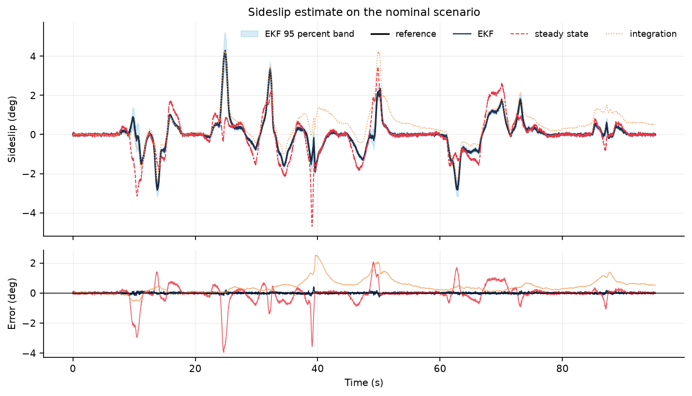

# Vehicle sideslip estimation

An Extended Kalman Filter that estimates sideslip angle from the sensors a race
car actually has: wheel speed, yaw rate and lateral acceleration. Steering angle
and longitudinal acceleration are treated as known inputs.

Sideslip angle is the angle between where the car points and where it is
travelling. It is the single best indicator of how much grip the rear axle has
left, and you cannot measure it directly. That makes it a good test of state
estimation: a model-based filter has to combine noisy measurements with a tyre
model that is never exactly right.

## Data

The driving input is a real lap. `scripts/fetch_telemetry.py` pulls lap 20 of the
2024 Bahrain Grand Prix for car 1 from the public [OpenF1](https://openf1.org/)
API, resamples it to 50 Hz and derives the steering trace from the path geometry.

| Property | Value |
| --- | --- |
| Samples | 4,760 at 50 Hz |
| Lap time | 95.18 s |
| Speed | 18.1 to 82.8 m/s |
| Peak steering (derived) | 14.7 deg |

Formula 1 does not broadcast steering angle, so it is reconstructed: the path
from the position feed is smoothed with a spline, curvature is computed from the
first and second derivatives, and steering follows from the wheelbase. The
assumption is kinematic and holds while the tyres are not saturated. It is the
main approximation on the input side and the report says so.

## Vehicle model

A single track model in the ISO 8855 body frame with the state

```
x = [vx, vy, r]      longitudinal speed, lateral speed, yaw rate
```

Lateral tyre forces come from a Pacejka magic formula per axle, and axle load
includes downforce because an F1 car generates more than its own weight in grip
at speed. Without downforce the model could not follow the lateral accelerations
in the reference lap.

Derivatives:

```
vx_dot = ax + vy * r
vy_dot = (Fyf * cos(delta) + Fyr) / m - vx * r
r_dot  = (a * Fyf * cos(delta) - b * Fyr) / Iz
```

The filter uses the analytic Jacobian, and the test suite checks every entry of
it against central differences.

## Reference simulation

Nothing can be validated against a real sideslip trace without a real sideslip
sensor, so the reference is a simulation driven by the real speed and steering
traces. The reference car is deliberately not the filter's model:

- tyre forces pass through a first order relaxation model with a relaxation
  length of about 0.6 m, which the filter does not model
- parameters can be changed independently of the filter

That gives the filter something real to be wrong about. Sensor noise is added on
wheel speed (0.10 m/s), yaw rate (0.006 rad/s), lateral acceleration (0.10 m/s2),
steering (0.0015 rad) and longitudinal acceleration (0.15 m/s2).

## Estimators compared

| Estimator | What it does |
| --- | --- |
| EKF | Three state filter, Joseph form covariance update |
| Steady state | Textbook linear bicycle model fed with measured lateral acceleration |
| Integration | Integrates ay - vx * r to get lateral speed, then takes the ratio |

The measured noise covariance `R` is deliberately larger than the sensor noise.
The extra term absorbs the part of the model error that appears at measurement
frequency, mainly tyre relaxation. With sensor-only values the filter is
overconfident and the normalised error sits near 10; with the tuned values it
sits at 2.6, which is close to the expected 3 for three states.

## Results

Sideslip RMSE in degrees over the lap, after a one second warm up.

| Scenario | EKF | Steady state | Integration | NEES |
| --- | --- | --- | --- | --- |
| Nominal | 0.047 | 0.621 | 0.638 | 2.6 |
| Rear stiffness 26% low | 0.327 | 0.721 | 0.638 | 15.5 |
| Centre of gravity 10 cm forward | 0.081 | 0.667 | 0.638 | 3.4 |
| Car 40 kg heavier | 0.109 | 0.621 | 0.638 | 2.9 |
| Noise doubled plus biases | 0.098 | 0.626 | 3.864 | 9.7 |
| Steering scaled by 1.12 | 0.049 | 0.735 | 0.674 | 2.6 |

The filter is more than an order of magnitude better than the steady state
estimate on the nominal lap, and it stays ahead on every scenario. The
integration estimate has a 0.44 deg bias because an unbiased accelerometer
cannot be assumed, and the bias grows without bound.



Sensitivity to a wrong rear cornering stiffness is the weakest point. A 30%
error in rear stiffness moves the estimate by 0.22 to 0.41 deg RMSE, because
sideslip is mostly set by the balance between the axles:

| Rear stiffness relative to reference | EKF RMSE (deg) |
| --- | --- |
| 0.70 | 0.405 |
| 0.85 | 0.171 |
| 1.00 | 0.047 |
| 1.15 | 0.129 |
| 1.30 | 0.218 |

The estimate stays usable, but this is the parameter to identify first on a new
car. Mass uncertainty matters less: a 5% mass error costs 0.06 deg.

## What this does not do

- No load transfer, no combined slip and no camber. A two track model would be
  the next step, and it matters most at the limit.
- The reference is a simulation, not a measurement. The numbers show how well
  the filter recovers a state that a known model produced. They do not prove
  accuracy on a real car.
- The steering input is reconstructed from position, so its error is shared by
  the reference and the filter.
- Road banking is ignored, which biases a lateral accelerometer in reality.
- Sensor biases are not estimated as states; they only appear as a stress test.

## Running it

```
python -m venv .venv
source .venv/bin/activate        # Windows: .venv\Scripts\activate
pip install -e ".[dev]"

python scripts/fetch_telemetry.py    # rebuild the lap from OpenF1 (cached)
python scripts/run_experiments.py    # metrics and figures
pytest
```

The committed lap CSV means the experiments run without network access.

## Layout

```
src/sideslip/
  model.py        vehicle model, tyre curve, Jacobians
  simulation.py   reference car with tyre relaxation and sensor model
  ekf.py          Extended Kalman Filter
  estimators.py   baselines and filter diagnostics
  evaluate.py     scenarios, metrics, sensitivity sweeps
  plots.py        report figures
  cli.py          command line entry point
scripts/          telemetry download, experiment runner
tests/            Jacobian checks, filter behaviour, accuracy bounds
data/             one lap of real telemetry
artifacts/        metric dumps
reports/          figures
```

## License

MIT. Telemetry belongs to Formula 1 and is accessed through the public OpenF1
API.
